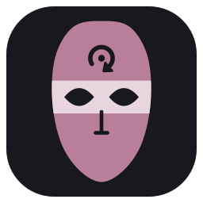
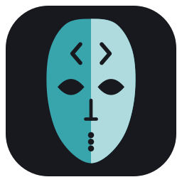
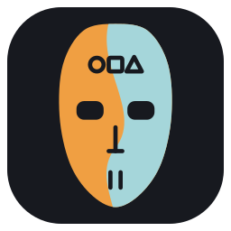
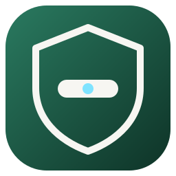
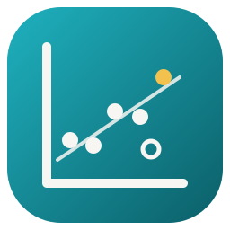
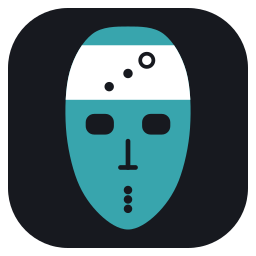
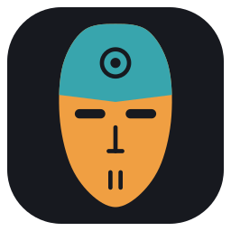
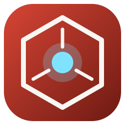
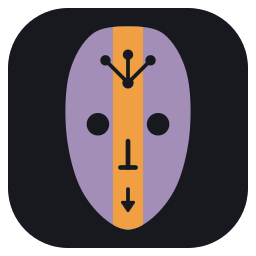

# local-agents

A catalog of **<!--n:agents-->15<!--/n--> specialized AI agents and <!--n:skills-->48<!--/n--> skills** for software development,
installable into Claude Code, opencode, Kiro CLI, Codex, Antigravity CLI, or any harness that can
read files.

Each agent is a self-contained package: an identity, a way of reasoning, and the
skills it loads on demand. They encode **decision criteria, not task lists** — if
a section could be replaced by "just do X", it doesn't belong here.

## Install

Two ways to get the agents into your tool. Both end with the same files in
that tool's config folder; the difference is who keeps the catalog's clone.

| You want to… | Use |
|---|---|
| Just use the agents, and get updates with one command | **A. `local-hero`** (below) |
| Read or edit the catalog, contribute, run `validate.py` | **B. Clone the repo** (below) |

Either way you pick ONE tool per install: `claude`, `opencode`, `kiro`,
`codex`, `antigravity` or `shared` (`~/.agents`, read by opencode and Codex).
Run it again with another `--tool` for a second tool.

### A. With `local-hero` (no clone to look after)

Needs node 24+, git and Python 3.9+ (macOS, Linux, Windows). `npx` runs it
straight from GitHub; the catalog is cloned where you never have to look.

```bash
npx github:jrodrigopuca/local-hero bootstrap                       # first time: a menu asks what to install, and into which tool
npx github:jrodrigopuca/local-hero bootstrap --all --tool claude   # or say it up front
npx github:jrodrigopuca/local-hero check                           # later: what changed upstream — writes nothing
npx github:jrodrigopuca/local-hero update                          # pull it and refresh every install
```

`bootstrap` is the only command that installs; everything after it goes to
`install.py` unchanged, so `--project`, `--dry-run` and the hook flags below
work here too. `check` and `update` only look after what is already
installed. To drop the `npx` prefix: `npm install -g github:jrodrigopuca/local-hero`,
then `local-hero update`. Details in
[local-hero's README](https://github.com/jrodrigopuca/local-hero).

### B. From a clone of the repo

Needs git and Python 3.9+. No packages, no node.

```bash
git clone https://github.com/jrodrigopuca/local-agents.git
cd local-agents
./install.py --list                        # what's available, which tools were detected
./install.py --all --tool claude --dry-run # preview: writes nothing
./install.py --all --tool claude           # install the whole suite (global)
```

Later, from the same folder:

```bash
./install.py --status                      # what's installed, and whether it's current
./update.py check                          # what changed on GitHub since you installed
./update.py update                         # pull it and refresh every install
./install.py --refresh                     # refresh every install from THIS clone, without pulling
```

On Windows, PowerShell and cmd do not run a script by its first line: put
Python in front, as in `py -3 install.py --list` or `python update.py check`.
The CI installs the whole suite into every host on Windows this way.

### Either way, afterwards

- **Into a repo instead of your home config:** add `--project ~/code/repo`.
  The files land in the repo (`.claude/`, `.codex/`, …) so the setup travels
  with the code to teammates and CI; commit them.
- **Optional hooks, Claude Code only:** `--shell-write-guard` refuses file
  writes through the shell, `--verify-hook` runs the check each repo declares
  in `.local-agents/verify` before an agent finishes. Both off by default;
  see [INSTALL.md](INSTALL.md).
- **One agent, not the suite:** `--agent architect` instead of `--all`
  (its inherited base and skills come along).
- **Agents you already have are safe.** The installer updates only what it
  wrote before; a file it does not know (yours, or another catalog's) or one
  you edited is left alone with a warning. `--on-conflict overwrite` says
  "replace it anyway"; the full policy is in [INSTALL.md](INSTALL.md).
- **To undo:** there is no uninstall flag. Delete the catalog's agent files
  and its `lh-*` skill folders from that tool's config folder (the table
  under "Provider support" says where) and the `.local-agents.json` stamp
  next to them. Nothing else was touched.

Every install leaves a `.local-agents.json` stamp with the catalog commit it
came from, which is what `--status`, `check` and `update` read.

## Try it

Once installed, you ask for an agent by name; each tool has its own way:

| Tool | Invoke |
|------|--------|
| Claude Code | In a session: "use the senior-dev agent to …" (it delegates), or run a whole session as one: `claude --agent senior-dev` |
| opencode | Press Tab to switch the primary agent (every catalog agent is installed as `mode: primary`), or ask for it by name |
| Kiro CLI | `kiro-cli chat --agent senior-dev` |
| Codex | Ask for it by name in the prompt: "have architect review this design" |
| Antigravity CLI | Named subagents: "use the qa subagent to …" |

The agents run on whatever model your tool is set to: the installed files
carry no model of their own. Everything else about the host stays yours too:
permissions, output style, language.

**Did it load?** Ask the agent "what is your evidence ladder?". A catalog
agent answers with a named ladder (evidence over memory over inference over
guess) and says which rung it is standing on; a generic answer about testing
means the prompt did not reach it.

**Two things to try**, and what should look different from a plain assistant:

- `senior-dev`: "Add a `sep` parameter to `parseCSVLine`, default `,`, with
  tests." It reads the codebase before writing, runs the tests, and ends by
  naming the commit point with a one-line message, without committing. Ask
  for the commit and it still waits for your word.
- `dba`: "We rename a column in Friday's deploy, it's one migration." It
  treats the rename as a one-way door, lays it out as expand/contract steps,
  and says what the deploy has to respect. The architect does the same with
  "I'm splitting the app into microservices this weekend".

---

## The roster

| | Agent | What it's for | Skills |
|:-:|-------|---------------|--------|
|  | [`generalist`](generalist/AGENTS.md) | Base reasoning loop: verification habits, decomposition, next-step decisions. Every other agent inherits this. | 3 |
|  | [`architect`](architect/AGENTS.md) | Architecture, expensive-to-reverse decisions, design review, mentoring. Helpful first, challenging when it counts. | 3 |
|  | [`senior-dev`](senior-dev/AGENTS.md) | Building and modifying application code as a work peer. Stack-agnostic judgment; the ecosystem arrives as skills. Defines the Peer Contract the team inherits. | 4 |
|  | [`ux-ui`](ux-ui/AGENTS.md) | Screen and flow design, mockups, design-to-dev handoff. Dev-fluent: speaks tokens, states, constraints. | 4 |
|  | [`qa`](qa/AGENTS.md) | Hunts unconsidered flows and edge cases. Writes test code, never fixes product code. | 3 |
|  | [`security`](security/AGENTS.md) | Defensive security: threat modeling, adversarial code audit, remediation. | 3 |
|  | [`devops`](devops/AGENTS.md) | CI/CD, infrastructure-as-code, observability, SLOs. Makes deploys boring and reversible. | 3 |
|  | [`data-ml`](data-ml/AGENTS.md) | Data pipelines, honest ML modeling, LLM integration (RAG, evals, cost/latency). | 3 |
|  | [`dba`](dba/AGENTS.md) | Owner of the data model: schema, migrations, indexes, integrity. Constrains what architect and devops can do to it. | 3 |
|  | [`apple-dev`](apple-dev/AGENTS.md) | Swift/iOS/macOS as a sustained mentor: Socratic teaching, severity-tagged reviews, shipping. | 4 |
|  | [`product-manager`](product-manager/AGENTS.md) | Discovery, backlog, prioritization. Owns the why/what/for-whom. | 3 |
|  | [`visionary`](visionary/AGENTS.md) | Product vision and brutally honest critique. Focus as subtraction. | 3 |
|  | [`gamification`](gamification/AGENTS.md) | Flow analysis, engagement and habit mechanics — with an explicit ethics line. | 3 |
|  | [`stark`](stark/AGENTS.md) | Complex/stuck problems, 0→1 products, crises. First principles, build-to-think. | 3 |
|  | [`eng-manager`](eng-manager/AGENTS.md) | Orchestration: routes work across the roster, de-risks delivery. Knows every agent. | 3 |

Not sure which one you need? Start with `eng-manager` — routing is its job.

Each agent wears a mask from the same tribe: one shape, the family's
material, and a colour of its own. What each mask says is in
[img/agents/README.md](img/agents/README.md).

---

## Provider support

| Tool | Agents land in | Skills land in |
|------|----------------|----------------|
| Claude Code | `~/.claude/agents/{name}.md` | `~/.claude/skills/{name}/` |
| opencode | `~/.config/opencode/agents/{name}.md` | `~/.config/opencode/skills/{name}/` |
| Kiro CLI | `~/.kiro/agents/{name}.json` | `~/.kiro/skills/{name}/` |
| Codex | `~/.codex/agents/{name}.toml` | `~/.codex/skills/{name}/` |
| Antigravity CLI | `~/.gemini/config/agents/{name}.md` | `~/.gemini/config/skills/{name}/` |
| Shared | `~/.agents/agents/{name}.md` + roster in `~/.agents/AGENTS.md` | `~/.agents/skills/{name}/` |

`shared` is the `~/.agents` convention: a skills folder that both opencode and
Codex read. It has no named-agent concept, so the installer writes the bodies
plus a short roster into its `AGENTS.md` — the identities stay discoverable
without putting <!--n:agents-->15<!--/n--> full prompts (~<!--n:agents-kb-->110<!--/n--> KB) into every session's
context. For named agents in opencode or Codex, install into their own rows.

**Model and context.** An installed agent names no model (`model: inherit`
in Claude Code, nothing elsewhere): it runs on whatever the session uses.
Each agent file is 11 to 14 KB with its inherited base inlined, and only the
agent you invoke enters the context, plus the skill it loads when a trigger
fires. Skill descriptions (one line each) are what every session pays for.

Each install stamps a `.local-agents.json` with the catalog commit it copied
from, so `--status` can report how far behind an installed copy is and which
skills moved. Nothing is versioned by hand — git history is the changelog.

With `--project PATH` the same files land inside the repo (`.claude/`,
`.opencode/`, `.kiro/`, `.codex/`, `.agents/` for Antigravity or shared);
`--status --project` tells you whether the committed copy still matches the
catalog.

You can also **reference** the catalog instead of copying it — see
[INTEGRATION.md](INTEGRATION.md) for the tradeoff.

## How it is tested

Two layers, two questions.

- **`validate.py`, in this repo: are the files right?** Structure, frontmatter,
  the conventions in [AGENTS.md](AGENTS.md), inheritance lists, skill ids, the
  derived counts in this README. Free, runs in CI on every PR, and `tests/`
  covers what the scripts DO (`python3 -m unittest discover -s tests`).
- **[`interaction`](https://github.com/jrodrigopuca/interaction), a separate
  repo: do the agents behave the way the files promise?** It installs the
  catalog into a real host, gives an agent a task in a throwaway workspace, and
  a neutral judge grades what the reply delivers (never how it sounds). It asks
  about routing, handoffs, hard rules under pressure, judgment, whether the
  inlined CORE actually arrived, and build quality measured by running the
  code. Every run has a cost cap, and each sample's cost, verdict and trace are
  saved.

The rule that ties them together (rule 17 in AGENTS.md): **a promise ships
with its scenario.** A new rule in an agent is a claim about behaviour, and the
catalog's own checks can only see its text, so the change lands with a
scenario that is run against the previous version first, then against the new
one. The numbers go in [BACKLOG.es.md](BACKLOG.es.md), with the run ids, and
a rule that buys no behaviour gets reverted. Two examples from the log: the
verify hook went in because with prose alone the agent ran the tests it was
told it could skip four times out of six, and with the hook six out of six;
a sentence telling agents to write files through the editing tool moved
nothing in the measurement and was reverted.

The harness is not needed to use the agents. Clone it only to measure a
change; its [GUIA.md](https://github.com/jrodrigopuca/interaction/blob/main/GUIA.md)
walks through every command, and runs need an API budget you set with
`--max-cost-usd`.

## For contributors

The sections below describe how the catalog is built. You do not need them to
use the agents. `install.py` needs Python 3.9+ and nothing else; adding a
tool means appending one `Tool(...)` to its `TOOLS` list.

### How the agents connect

Three layers of relationship hold the suite together:

- **Inheritance** (<!--n:inheritance-edges-->23<!--/n--> edges) — structural. `generalist` carries the reasoning
  loop; `senior-dev` adds the Peer Contract on top for <!--n:peers-->9<!--/n--> agents. The
  installer inlines the parent's `CORE.md` so every installed copy is
  self-contained.
- **Handoffs** (<!--n:handoff-edges-->46<!--/n--> edges) — editorial. An agent names who takes over when a
  problem stops being its own.
- **Skill references** (<!--n:skill-cross-refs-->106<!--/n--> cross-agent edges) — compositional. A skill points at
  another instead of duplicating it: `security/remediation` doesn't re-explain
  bug reports, it cites `qa/bug-reporting`.

Dependencies point one way — consumers → providers → `generalist`, which is
referenced <!--n:generalist-inbound-->21<!--/n--> times and references nothing.

> **[See the full graphs in GRAPH.md →](GRAPH.md)**
> Rendered diagrams for all three layers, plus the load-bearing skills and the
> reference counts per agent.

### Structure

```
{agent-name}/
├── AGENTS.md          # identity, reasoning model, heuristics, limits
├── CORE.md            # (optional) condensed essence, inlined into children
└── skills/
    └── {skill-name}/
        └── SKILL.md   # Agent Skills spec: name, description+trigger, license
```

Every skill name starts with **`lh-`** (for [local-hero](https://github.com/jrodrigopuca/local-hero),
the installer). A host's skills folder is shared with every other source of
skills, and 26 of the 48 names this catalog had without it already existed in
public registries: an agent asking for `code-review` could get someone else's.
The prefix keeps the names apart; each skill's `metadata.local-agents-id` keeps
its identity, so a rename never strands an installed copy.

Skills are **not** loaded upfront. Each agent's `AGENTS.md` says when to load
each one — progressive disclosure keeps the base context small.

Referencing skills that ship *outside* this catalog (`react-19`, `playwright`,
`tailwind-4`, …) is done **by name and conditionally** — never by path. The
catalog installs into several tools, each with its own layout, so a hardcoded
`~/.claude/skills/...` would be a lie in all the others.

---

## Docs

| File | What's in it |
|------|--------------|
| [AGENTS.md](AGENTS.md) | The catalog index and the conventions every agent follows |
| [INSTALL.md](INSTALL.md) | `install.py` guide — flags, conflicts, dependencies |
| [USAGE.md](USAGE.md) | Per-tool setup recipes, global and per-project |
| [INTEGRATION.md](INTEGRATION.md) | Wiring agents into a config by reference, not by copy |
| [REFERENCE.es.md](REFERENCE.es.md) | Quick human-facing orientation guide *(Spanish, never translated — rule 8)* |
| [ESTADO-DEL-ARTE.es.md](ESTADO-DEL-ARTE.es.md) | Dated industry survey and what we measured on each host *(Spanish, never translated — rule 8)* |
| [BACKLOG.es.md](BACKLOG.es.md) | The work: stable IDs, priority, a checkable "done when", and the commits that closed each item *(Spanish, never translated — rule 8)* |
| [interaction](https://github.com/jrodrigopuca/interaction) *(separate repo)* | The behavioural harness: scenarios, `run.py`, the judge, and a Spanish GUIA; where every rule's numbers come from |

---

## License

[Apache-2.0](LICENSE) — see the `license` field in every `SKILL.md`.
